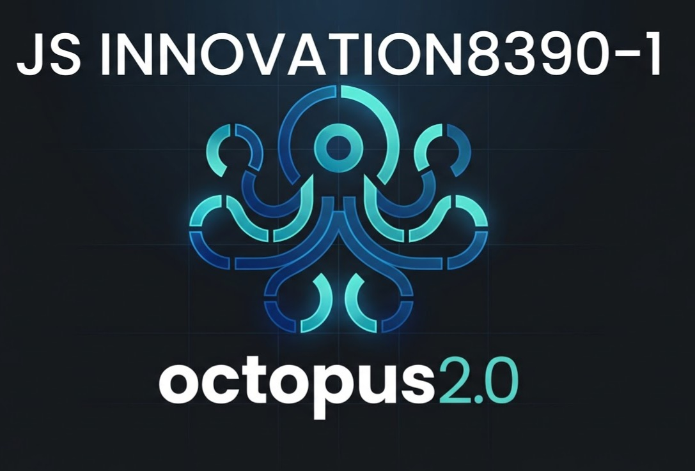

  

<b>Octopus 2.0 (Click to Expand Core Features)</b>

### Core Fintech Architecture & Capabilities
Welcome to the official repository for **Octopus 2.0**—an offline-first, decentralized settlement and compliance engine designed for ultimate financial autonomy.

* **Offline-First SQLite Ledger**: Enables secure peer-to-peer local accounting and transaction logging without requiring constant server connectivity.
* **NFC Proximity Settlement**: Facilitates rapid, secure contactless transaction handshakes between devices.
* **ISO 20022 Compliance Engine**: Automatically formats financial messaging to meet international banking standards and regulatory requirements.
* **Cryptographic Provenance**: Leverages SHA-256 hashing to ensure complete auditability and data integrity across all local nodes.
* **Virtual Card & Token Generation**: Dynamically spins up secure, localized credentials for isolated transactions.

---

## Licensing & Usage Terms

* **Free for the Community:** 100% free for individual advocates, community lawyers, pro-bono defense teams, students, and researchers fighting for public accountability and access to justice.
* **Commercial / Corporate Use:** Any corporation or profit-generating business utilizing this software must acquire a formal commercial license and royalty agreement from **JS Innovation 8390-1 Inc.**
* **Mandatory Attribution:** All derivative works, deployments, or references must explicitly credit **Jujita Fermin Stairs** to maintain intellectual integrity, dignity, and reputation.

## Structural Validation: Systemic Financial Profiling & Real-Time Constraints

### 1. The Real-Time Bottleneck Hypothesis
- **External Constraints vs. System Architecture:** The inability of independent protocols to execute seamless, real-time clearing across Canadian financial institutions is not a technical failure of software design or protocol execution. 
- **The Profiling Barrier:** It is the direct consequence of systemic financial profiling and asymmetric risk gating imposed by centralized financial institutions, which restrict independent entities to legacy, manual, or physical-only workflows.

### 2. The Path to Sovereign Settlement
- **Empirical Status:** Until Canadian financial institutions remove algorithmic profiling and structural access discrimination, these operational friction points remain externally enforced administrative barriers rather than engineering limitations.
- **Deterministic Independence:** Octopus 2.0 bypasses this gatekeeping by anchoring execution to cryptographic proof and protocol-level rules, rendering external institutional bias observable and transparent.
